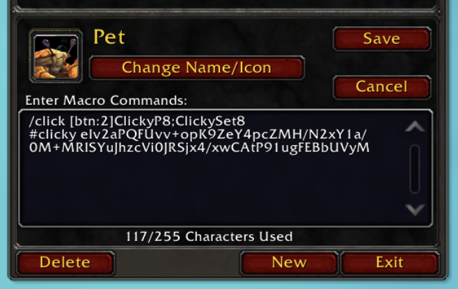

# Clicky

Clicky turns your toys, mounts, pets, spells and items into action bar buttons. Star toys in the Toy
Box and the Favorites button uses one of them each time you click it. Or group toys, mounts, pets,
spells and things from your bags into your own macros, such as costumes, hearthstones, portals or
the pets that chase a laser pointer, and give each group its own button. Click a button for a random
one from it, or right-click it for a drawer of what it holds and choose one. Your macros follow you
to every computer you play on.


## Installation

Clicky is for World of Warcraft Retail (Midnight). It's on
[Wago](https://addons.wago.io/addons/clicky), not CurseForge. It only has alpha
releases so far, so if your addon manager hides alpha releases, turn them on for Clicky. To
install by hand, download it from Wago and unzip it into
`World of Warcraft/_retail_/Interface/AddOns`, so that you have an `AddOns/Clicky` folder.

## Getting started

1. Type `/clicky`. The Toy Box opens, showing Clicky's grid and, on its right, the Clicky panel,
   titled **Macros**.
2. Right-click a toy, a mount, a pet, a spell or an item you own, choose **Add to new macro...**,
   and name the macro.
3. Right-click more and tick your macro's name.
4. Drag the macro's icon from the panel onto an action bar.
5. Click it to use a random one from the macro. It skips the one it used last, unless that's the
   only one ready. Right-click it to choose one from its drawer.

Clicky's messages call everything a macro holds an *item*: a toy, a mount, a pet, a spell, or
something in your bags or that you're wearing. Favorites holds only toys, so its messages say toys.

## What you can do

**Dress up at random.** Make an **Illusion** macro with your costume toys, and an **Illusion mod**
macro with hats, wings and other toys that add to your look. Click Illusion for a random costume,
then Illusion mod for a random extra on top. Click either again for a new look.

**Take whichever hearthstone is ready.** Put your hearthstone toys in a **Hearthstones** macro. A
click uses a random one that isn't on cooldown. Right-click for its drawer, which shows each one's
cooldown, and click the one you want.


**Keep your portals on one button.** Put your portal toys, your "Path of the ..." spells and a
teleport cloak from your bags in a **Portal** macro. Click for a random toy or spell, or
right-click and pick where you're going from the drawer. The cloak is only in the drawer: a click
never picks gear (see "Wearable items" below).

**Bring out a pet to chase the Laser Pointer.** On the **Pets** tab, put the pets that play with
the Laser Pointer toy in a **Laser** macro. A click summons a random one of them, not the pet you
already have out. A pet you own in three colors shows three times, so you choose the colors.

**Ride one of a few mounts.** On the **Mounts** tab, put a handful of mounts in a **Ride** macro. A
click summons a random one that can be used where you are.

**Put your favorite toys on one button.** Star toys in the Toy Box and drag **Favorites** from the
Clicky panel to a bar. It uses a random starred toy. Star or unstar a toy and it changes straight
away.

**Add a line of your own.** Paste a macro's `/click` line into a macro of yours, with a `/say`
line, and you say something each time you click it (see "Using a macro's items from your own
macros" below).

**Play on another computer.** Install Clicky there and your macros are in the panel and on your
bars, with what they hold. Nothing needs copying.

## Using Clicky

### The grid

Clicky shows its own grid in place of the Toy Box's, with a tab each for **Toys**, **Mounts**,
**Pets**, **Spells** and **Items**.

The **Toys** tab lists your favorites first, each with the Toy Box's star, then the rest of your
toys, then the toys you don't have if you've ticked **Not Collected**. Each group is sorted by name.
Click a toy to use it, drag it to an action bar, or shift-click it to link it in chat. A check mark
means it's in one of your Clicky macros. Favorites' toys have their star instead.

The **Mounts** tab lists the mounts you've collected, and the **Pets** tab your pets, one for each
species and color you own. Each lists your favorites first, with the journal's star, then the rest
by name. Click a mount or a pet to summon it; drag, shift-click and right-click work as on toys.

The **Spells** tab lists the spells you know, your professions' included, and the **Items** tab the items in your bags or worn,
each sorted by name. The Items tab lists only items with a "Use:" effect that Clicky's own list has
(see "How it works"). Click a spell to cast it and an item to use it; gear you aren't wearing is
worn when you click it. Drag, shift-click and right-click work as on toys.

Favorites stays toys only: it's your Toy Box stars. Mounts and pets have their own stars, and WoW
has its own buttons for a random favorite mount or pet.

Search in the search box; it looks at every tab and finds more than names (see "Details"). The
Toys, Mounts and Pets tabs each have a **Filter** menu like the Toy Box's, the Mount Journal's and
the Pet Journal's, starting with collected ones only. These are Clicky's own: your Toy Box, Mount
Journal and Pet Journal filters stay as you set them.

### Favorites

Favorites is always at the top of the panel. It uses the toys you've starred in the Toy Box, so
starring or unstarring a toy changes it straight away. Drag it to a bar like any other macro; its
macro, called Favorites, is made the first time you drag or rename it. You can rename it and
delete it like your own macros.

### Adding and removing items

Right-click a toy, mount, pet, spell or item you own in the grid. Under **Clicky macros** (below
**Set Favorite** or **Remove Favorite** on a toy, mount or pet), each macro has a checkbox with its
name, ticked if the item is in it. Click one to put the item in that macro or take it out. The menu
stays open, so you can put one item in several macros. Right-clicking an item in the Clicky panel
gives the same choices. Spells and items have no Set Favorite.

### The drawer

Right-click a macro's button for its drawer: everything in the macro you have, in the panel's
order, with cooldowns. Click one to use it. The drawer closes when you choose, press Escape,
right-click again or move the mouse away.

### Pets

A pet in a macro is a species in one color, and stands for every pet of that color you own. A
click summons one that isn't out: summoning the pet you already have out would put it away.

### Wearable items

A click on a macro never picks gear that can be worn, such as a teleport cloak. WoW's item action
wears gear that isn't worn instead of using it, so a random pick could change your equipment.
Choose it from the drawer: clicking it there wears it if it isn't worn, and uses it once it is.

### Seeing a macro's items

Click a macro in the panel to list what it holds, and click it again to hide it. Items you don't
have (a toy you don't own, a mount you haven't collected, a pet color you have no pet of, a spell
you don't know, something no longer in your bags) are greyed out; you can still remove them.

### Renaming and deleting

Right-click a macro in the panel and choose **Rename** or **Delete**. Deleting asks you to confirm,
then removes the macro from your bars too. Renaming or deleting it in `/macro` works the same way.
Two Clicky macros can't have the same name.

### Using a macro's items from your own macros

Right-click a macro in the Clicky panel, choose **Copy /click line** and copy the line it shows.
Paste it into a macro of your own to use a random item from the Clicky macro there too:

```
/click ClickyBCDF
/say Surprise!
```

### Copying a macro

Make a new general macro in `/macro` and paste in the old macro's text. From then on the two are
separate, so changing one leaves the other alone.

## In combat

Your buttons and drawers work in a fight. A click picks from the items that were ready when the
fight started: an item that comes off cooldown mid-fight waits until the fight ends, and one that
goes on cooldown mid-fight can still come up, showing WoW's error for that click. A pet that
comes out mid-fight can still come up too, and that click puts it away.

WoW doesn't let addons make or change macros in a fight, so you can't make, rename or delete
macros, add or remove their items, or drag macros from the panel until it ends.

`/clicky` in combat says "Can't open the Toy Box in combat." Open the Toy Box before the fight.

The grid's buttons still work in a fight. Shift-click and right-click work too, and a
toy still in its gift wrap opens when you click it (use it after the fight). A toy you use shows
its cooldown, and hovering over a toy you learned this session clears NEW (a toy in its gift wrap
keeps NEW until you click it). Otherwise the grid stays as it is: the scroll bar is off, the tabs
don't change, and a search, a filter or something you learn, pick up or star shows when the fight
ends. If you first
open the Collections window in a fight, the Toy Box shows its own grid until the fight ends.

## Details

**The grid.** Each tab says how many it lists, as **Toys (809)**, and the counts follow the search.
The mount you're on and the pet you have out are highlighted, here and in drawers, as in the
journals. Not Collected lists the same toys as the Toy Box's own Not Collected; on Pets it shows
each species you have none of once. A mount WoW hides on this character isn't listed. The grid
scrolls in whole rows, with the mouse wheel or the scroll bar, and a wheel notch moves three. A
search, a filter or another tab takes you back to the top.

**A pet you have two of in one color.** A click summons a starred one first, so starring a pet in
the Pet Journal picks which of the two comes out.

**A drawer with nothing you have.** If you have none of a macro's items, a right-click says so, as
a click does.

**A copied macro on another account.** The text of a Clicky macro works on your other WoW accounts
too.

**Mounts your Mount Journal filters hide.** WoW finds a mount to star or drag by its place in the
Mount Journal's list, so a mount your Mount Journal filters hide can't be starred or dragged from
Clicky's grid. You can still click it and put it in macros.

**NEW and gift wraps.** A toy you've just learned says NEW until you hover over it. A toy still in
its gift wrap says NEW until you click it, and that click unwraps it, without the Toy Box's
animation.

**Search.** It finds a name, a source ("Vendor"), an expansion, a mount type ("Flying"), a pet
family ("Beast"), or any words in the tooltip: "rested" finds what mentions rested experience,
which Blizzard's Heirlooms search, for one, doesn't.

**Filters.** On the Toys tab, the **Filter** menu shows toys you've collected and toys you haven't,
and **Usable Only** hides toys you have but this character can't use right now, with Sources and
Expansion as in the Toy Box. It starts with collected toys only. The Mounts menu has Unusable, the
mount types and Sources; the Pets menu has Battle Pets, Non-Combat Pets, Pet Families, Sources and
Sort By. Each tab keeps its own settings.

**A pet that's out, in the drawer.** Clicking a color whose only pet is out puts it away, as the
Pet Journal's Summon button does.

**Pet colors Clicky doesn't know.** A pet in a color Clicky's list doesn't have shows under its
species as one more entry, which stands for all such pets of that species. Once you have none left
(a Clicky update added their color), that entry stands for all your pets of the species, so it
keeps working in your macros.

**Hiding the Macros panel.** The arrow beside the grid's **Filter** button hides the panel; click it
again to bring it back. The panel is back each time you log in or reload.

**Deleting Favorites' macro.** Favorites stays in the panel, named Favorites again and ready to
drag.

## Limits

- 100 items per macro, in any mix of toys, mounts, pets, spells and items. A WoW macro holds 255
  characters, and Clicky keeps a macro's items in the macro itself (see "How it works"). 100 is the
  most that always fits, whichever you choose. For more, make a second macro. Favorites has no
  limit: its toys are your Toy Box stars, which WoW keeps for you, so its macro holds none.
- Macro names up to 16 characters, the most WoW's macro name box holds. A longer name is cut short.
- 120 general macros, shared by your whole account. Each Clicky macro is a general macro, so it's
  on every character on your account and takes one of those 120. Delete macros you no longer use
  in `/macro` to make room.
- No changes to macros in combat, because WoW doesn't allow them then (see "In combat").

## Slash commands

| Command | What it does |
|---|---|
| `/clicky` | Opens the Toy Box, with Clicky's grid and panel |
| `/clicky status` | Shows how many toys you own, then how many of each macro's items you have and how many are ready to use where you are |
| `/clicky debug` | Opens a window of Clicky's state, for a bug report. Click its text to select it all and press Ctrl+C to copy it; Escape lets go of the text, then closes the window. Tick **Trace** in it to add each pick and change below as it happens; tracing stops when you untick it, reload or log out |

## Troubleshooting

**I clicked and nothing happened.**
If the macro has no items, you'll see that it has none and how to add some. Otherwise none of its
items can be used right now. Clicky leaves out items you don't have, items on cooldown, gear that
can be worn (it's in the drawer only) and items that can't be used where you are. When nothing is
left, you'll see "No usable items in" and the macro's name (Favorites says "toys").

**An item showed an error.**
Some items pass Clicky's checks and still can't be used where you are; WoW shows its error. Your
next click picks again.

**Adding an item says the macro is too long.**
If you've added so many lines of your own to a macro in `/macro` that another item doesn't fit,
adding one says "That macro is too long to update. Remove your own lines from it in /macro."

**Adding an item says the macro is full.**
A macro holds up to 100 items (see "Limits"), and adding one more says "Illusion is full: a macro
holds up to 100 items." with your macro's name. Make a second macro for the rest.

**Making a macro says your general macros are full.**
WoW allows 120 general macros per account, and each Clicky macro is one of them. Making another
says "Your general macros are full. Delete one in /macro and try again."

**A change says "Can't change macros in combat."**
WoW doesn't let addons change macros in a fight. Make the change once it ends. Dragging a macro
from the panel in a fight says "Can't drag macros in combat."; drag it once the fight ends.

**`/clicky` says "Can't open the Toy Box in combat."**
WoW doesn't let addons open the Collections window in a fight. Open it once the fight ends, or
before the next one.

**Making or renaming a macro says "There's already a macro called" and its name.**
Two Clicky macros can't share a name. Choose another name.

**A macro does nothing on another computer, and isn't in its Clicky panel.**
That computer is still on Clicky 0.4.0, which doesn't recognize macros made by a
newer Clicky. Update Clicky there.

**A macro from Clicky 0.4.0 is greyed out in the panel.**
This version doesn't read macros Clicky 0.4.0 made. Delete it and make it again. Favorites'
button from 0.4.0 does nothing and has no row in the panel: drag Favorites from the panel to your
bar again; the old macro stays in /macro until you delete it.

**A macro's icon is greyed out with "?" for its item count.**
Clicky can't read that macro's items. Hover over it for the reason:

- "This macro was saved by a newer version of Clicky": update Clicky.
- "Clicky can't read this macro's items": its `#clicky` line was changed, or it was saved by
  Clicky 0.4.0 or 0.5.0. Delete it and make it again.

You can still rename it, delete it or move it on your bars.

**A toy, mount, pet, spell or item from the latest patch isn't in the grid.**
Clicky carries its own list of the game's toys, mounts, pets (each species in each color), spells
and items, and a patch's new ones join it when Clicky is updated for that patch. Until then it
isn't in Clicky's grid, so you can't add it to a macro. The grid also lists a spell or item only
while you know it or carry it.

**Something else is wrong, or you have an idea.**
Leave a comment on [Clicky's Wago page](https://addons.wago.io/addons/clicky).

## How it works

**Where are my macros' items stored?**
In the macros. WoW keeps your macros on Blizzard's servers and copies them to each computer you
play on, while addon settings stay on one computer. So Clicky writes each macro's items into the
macro as a line starting with `#clicky`, which does nothing when the macro runs. That line shares
the macro's 255 characters with the `/click` line and any lines you add, which is why a macro
holds up to 100 items.

**Can I edit a Clicky macro in `/macro`?**
Yes. You can add your own lines and Clicky keeps them. Leave the `/click` line and the `#clicky`
line as they are: your bars rely on the first, and the second holds the items. If the `#clicky`
line is changed, Clicky shows the macro greyed out with "?" rather than guess its items; delete it
and make it again. If either line is removed, the macro is no longer a Clicky macro: it leaves the
panel and no longer uses items.



**Why does each macro click something called Clicky plus four letters?** WoW only lets a toy be used
when you click something, not when an addon asks. So each macro clicks a hidden button called
`Clicky` plus four random letters, which holds the random item your click uses (a mount, a pet, a
spell or an item goes through the same button). A right-click goes to a second hidden button,
`ClickyP` plus the same four letters, which opens the drawer.

**Does Clicky change my settings?**
No. It changes only its own macros and buttons, a toy's, mount's or pet's star when you choose that
from its menu, and a toy's gift wrap when you click the toy to open it, as the Toy Box does. Your
Toy Box, Mount Journal and Pet Journal filters and other settings stay as you set them.

**What happens to an item I no longer have?**
It stays in the macro, greyed out in the panel and left out of the drawer, and is used again if
you get it back.

**What happens when a patch adds or removes toys, mounts, pets, spells or items?**
Your macros keep what they hold: Clicky carries its own list of the game's toys, mounts, pets,
spells and items,
so a patch can't change which a macro holds. You can add a patch's new ones once Clicky is updated
for that patch. One taken out of the game stays in your macros; you can remove it in the panel.

**What happens if I remove Clicky?**
Its macros stay in `/macro` and do nothing when clicked. Delete them there, or install Clicky
again and they work as before.

## Development

[docs/architecture.md](https://github.com/shadowpaxa/clicky/blob/main/docs/architecture.md) covers how the code fits together, running the
tests, and making releases.
