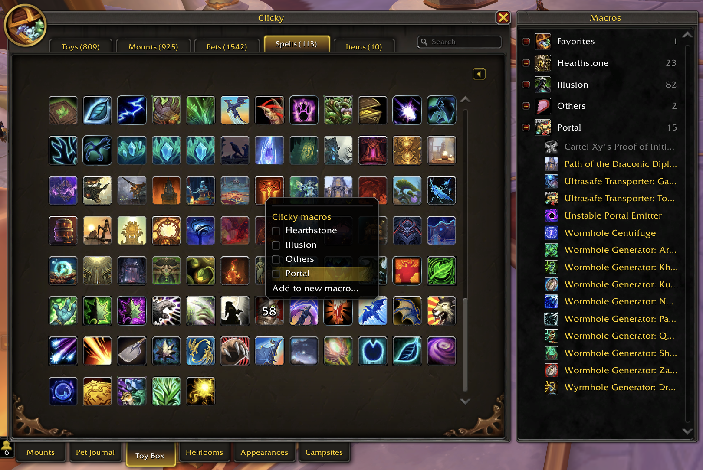
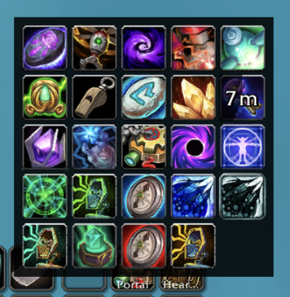

# Clicky

Clicky turns your toys, mounts, pets, spells and items into action bar buttons. Put a few of them
together in a macro, such as your costumes, your hearthstones or your portals. Clicking the button
uses a random one, and right-clicking it opens a drawer so you can pick one yourself. Your macros
are ordinary WoW macros, so they follow you to every computer you play on.



## Installation

Clicky is for World of Warcraft Retail (Midnight). Install it from
[Wago](https://addons.wago.io/addons/clicky) or
[CurseForge](https://www.curseforge.com/wow/addons/clicky) with your addon manager, or download it
there and unzip it into `World of Warcraft/_retail_/Interface/AddOns`.

## Getting started

1. Type `/clicky`. The Toy Box opens with Clicky's grid, and the **Macros** panel beside it.
2. Right-click something you have in the grid, choose **Add to new macro...**, and name the macro.
3. Right-click anything else you want in it and tick the macro's name.
4. Drag the macro's icon from the panel onto an action bar.

Now click the button for a random pick (it won't repeat the last one), or right-click it to choose
from the drawer.

## Ideas

- **Illusion:** your costume toys, for a new look every click.
- **Hearthstones:** a click picks one that's off cooldown.
- **Portal:** portal toys, your "Path of the ..." spells and a teleport cloak, all on one button.
- **Laser:** the pets that chase the Laser Pointer.
- **Favorites:** it's already in the panel. Star toys in the Toy Box, then drag Favorites to a bar.



## Using Clicky in other macros

Right-click a macro in the panel and choose **Copy /click line** to get a line like
`/click ClickyBXTR`. In a macro of your own, that line uses a random item from the Clicky macro,
whichever mouse button you click. Add a `P` after `Clicky` (`/click ClickyPBXTR`) and it opens the
drawer instead.

- **A button that's only random, or only the drawer:** make a macro with just that line and put it
  on your bar in place of the Clicky macro.
- **A random pick on something you already press:** make a macro that casts it and add the line.
  For a random costume every time you cast Power Infusion:

  ```
  #showtooltip Power Infusion
  /click ClickyBXTR
  /cast Power Infusion
  ```

- **Lines of your own in a Clicky macro:** you can add them in `/macro`. Just leave its `/click`
  and `#clicky` lines alone: one runs the button, the other is where Clicky keeps the list.

## Good to know

- The grid has a tab each for **Toys**, **Mounts**, **Pets**, **Spells** and **Items**. Toys,
  Mounts and Pets have their own **Filter** menus, so your Toy Box and journal filters stay as you
  left them.
- The search matches names, sources, expansions, mount types, pet families and words in the
  tooltip.
- A check mark in the grid means it's already in one of your macros.
- Right-click a macro in the panel to rename it, delete it, or open it in `/macro` to edit it.
- To change a macro's icon, click the macro in the panel to show its items, right-click the one
  whose icon you want and choose **Use as icon for Illusion** (with your macro's name).
- A click on a macro never picks gear that can be worn, because WoW would equip it instead. Pick
  it from the drawer: if you aren't wearing it, the first click puts it on, and after that clicks
  use it.
- Pets go in by species and color, so a cat you have in three colors shows three times on the Pets
  tab. A click summons one of your pets in that color, a starred one first, and never the one
  that's already out.
- Buttons and drawers keep working in combat, but you can't change macros until the fight ends.
- Clicky only changes its own macros, plus the stars and gift wraps you click. If you uninstall it,
  its macros stay in `/macro` and do nothing.

## Limits

- 100 items per macro. Need more? Make a second macro.
- 120 general macros, shared by your whole account, and each Clicky macro uses one. Full? Delete
  one you don't use in `/macro`.
- Macro names up to 16 characters. A longer name is cut short.

## Slash commands

| Command | What it does |
|---|---|
| `/clicky` | Opens the Toy Box with Clicky's grid and panel |
| `/clicky status` | Shows how many of each macro's items you have and can use here |
| `/clicky debug` | Opens Clicky's state to copy for a bug report. Tick **Trace** in it to record each pick and change |

## Troubleshooting

**Clicking a macro does nothing but say "No usable items in" and the macro's name.** Nothing in it
can be used right now: you don't have it, it's on cooldown, it's gear, or it doesn't work where you
are (Favorites says "toys").

**A macro is greyed out with "?" for its item count.** Hover over it to see why:

- "This macro was saved by a newer version of Clicky": update Clicky.
- "Clicky can't read this macro's items": its `#clicky` line was changed. Delete the macro and make
  it again.

**Something from the latest patch is missing.** Clicky needs an update before it can list what a
patch adds.

**Something else is wrong, or you have an idea?** Leave a comment on
[Clicky's Wago page](https://addons.wago.io/addons/clicky).

## Development

[CLAUDE.md](https://github.com/shadowpaxa/clicky/blob/main/CLAUDE.md) has the rules the code
follows, how to run the tests and how to release.

Clicky was inspired by [Select](https://www.wowinterface.com/downloads/info11607) by Gello.
